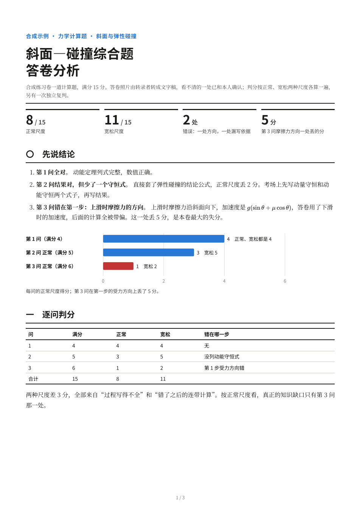
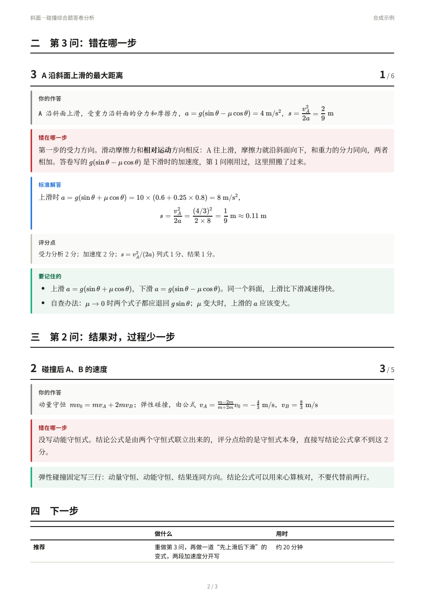

# kaoyan-study-skills

Agent skills for months-long exam prep in Claude Code and Codex: a tutor that makes you try first, and a grading pipeline you can audit.

```
/plugin marketplace add keienhrri-bit/kaoyan-study-skills
/plugin install kaoyan-study-skills@kaoyan-study-skills
```

Codex, `gh skill` and skills.sh: see [Install](#install).

 

Written for China's postgraduate entrance exam (考研, *kaoyan*) but usable for any long exam: tutoring, a grading pipeline for handwritten answers, checkpoint reviews, study-log archiving, daily study packs and a fixed Markdown-to-PDF report pipeline. The skills and their outputs are in Chinese. This page is a short English summary; the full documentation is in [README.md](README.md).

The screenshots come from the bundled synthetic example: an original mechanics problem taken from assignment through submission, transcription, grading, an independent regrade and the final report ([`examples/synthetic-mechanics/`](examples/synthetic-mechanics/)).

## What is in it

| Skill | What it does |
|---|---|
| `kaoyan-setup` | Creates the study workspace (folders, `AGENTS.md`, `CLAUDE.md`, status card, decision log, lessons log) and the config file `kaoyan.yaml` |
| `kaoyan-tutor` | Tutor that has you try first, then points to the exact step that went wrong; every step of a derivation comes with its justification |
| `kaoyan-grading` | Photo → transcript → you confirm unclear spots → rubric grading at two strictness levels → one independent regrade → report |
| `kaoyan-plan` | Checkpoint reviews and weekly plans: two different drafts, you choose |
| `kaoyan-archive` | Files exported study chats into the right subject folder; plans first, moves after a spot check, never deletes |
| `kaoyan-daily-pack` | A daily "read, then answer" pack plus a prompt for memorisation-heavy, multiple-choice subjects |
| `kaoyan-report` | Markdown → pandoc → KaTeX → headless Chromium → PDF, with an automatic layout check (unrendered math, blank pages, overflow) |
| `kaoyan-retro` | After a mistake by the AI: root cause, one line in the lessons log, a minimal fix that you approve |
| `physics-svg-tutor` | Teaches physics geometry with SVG diagrams; the case library focuses on optical interference |

Four subagents ship in `agents/`: `transcriber`, `regrader`, `writer`, `finder`.

## Install

Claude Code (skills and subagents):

```
/plugin marketplace add keienhrri-bit/kaoyan-study-skills
/plugin install kaoyan-study-skills@kaoyan-study-skills
```

Codex:

```bash
codex plugin marketplace add keienhrri-bit/kaoyan-study-skills
codex plugin add kaoyan-study-skills@kaoyan-study-skills
```

Skills only, with GitHub CLI (`gh skill` is a preview feature; tested with gh 2.101):

```bash
gh skill install keienhrri-bit/kaoyan-study-skills --all --agent claude-code --scope user
```

Or via [skills.sh](https://skills.sh) (not tested by the author): `npx skills add keienhrri-bit/kaoyan-study-skills`. These two routes do not install the subagents; the skills then fall back to a general-purpose subagent with the task brief in the prompt.

`kaoyan-report` needs Python 3.10+, [pandoc](https://pandoc.org/installing.html) and Chrome, Edge or Chromium. KaTeX 0.16.22 is bundled.

## Rules the skills follow

1. Let the student try first; then point to the step that went wrong.
2. Explain with derivations and reasons, not bare conclusions.
3. Hearing an explanation is not mastery; study evidence is logged in five kinds, from "answered alone first try" to "only listened".
4. Answer photos never enter the main session; a transcriber turns them into text, and unclear spots go back to the student.
5. Helpers return transcripts, issue lists and independently computed numbers; the main session writes everything the student reads.
6. Each deliverable is reviewed once. The regrader never sees the main session's scores.
7. Numbers are checked by scripts (SymPy for answers, exact-match lookup for quoted lecture lines), not by asking another model.
8. Plans are offered as options; the student decides.
9. Log every correction; a rule is proposed only when the same root cause shows up twice, and only applied with the student's approval.

## Limits

- Transcription accuracy has not been evaluated; the repository contains only synthetic data, no real handwriting.
- Run locally on Windows 11 only; CI covers Ubuntu and Windows, not macOS.
- No lecture notes or exam questions are included; bring your own legally owned materials.

## License

MIT. Bundled KaTeX is MIT as well (`skills/kaoyan-report/assets/katex/LICENSE`).
